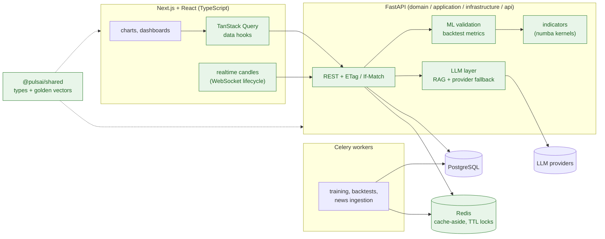
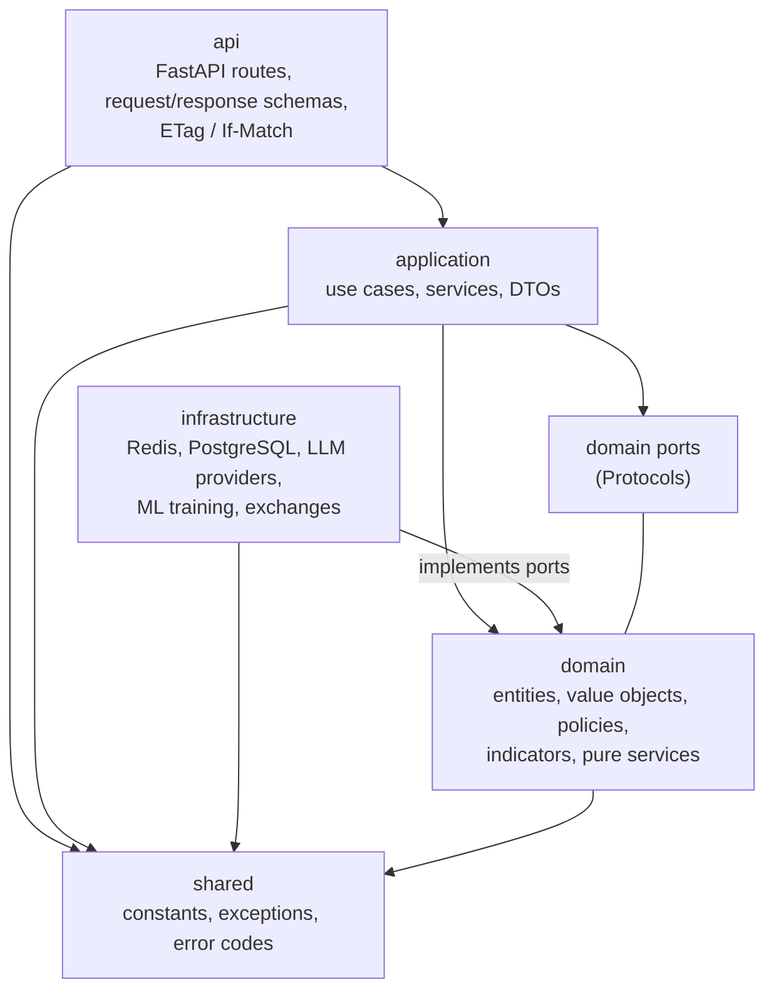
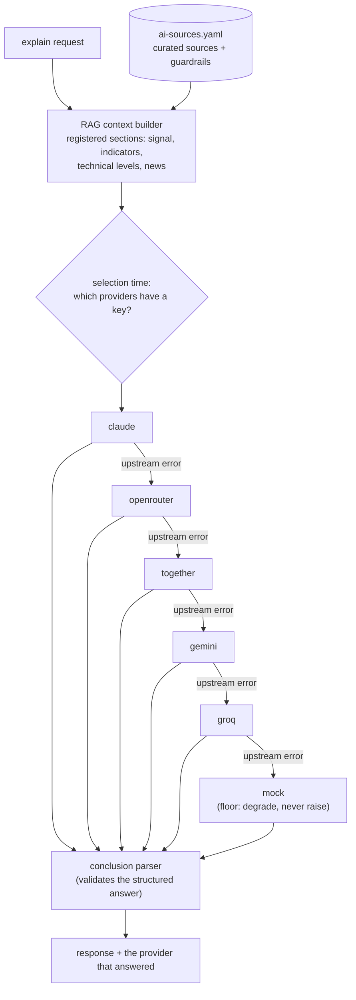
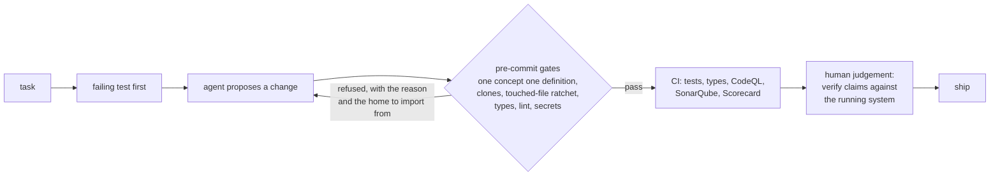
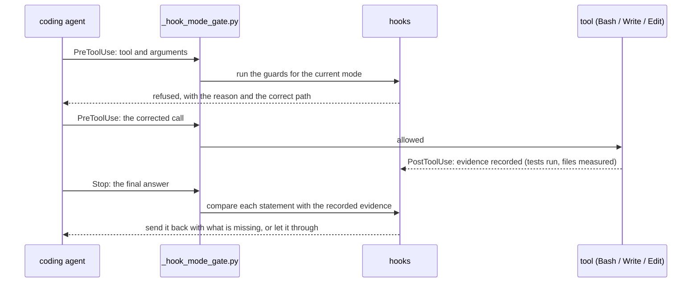

# pulsai-showcase

[](https://github.com/xexiu/pulsai-showcase/actions/workflows/ci.yml)
[](https://github.com/xexiu/pulsai-showcase/actions/workflows/codeql.yml)
[](https://scorecard.dev/viewer/?uri=github.com/xexiu/pulsai-showcase)
[](https://sonarcloud.io/summary/new_code?id=xexiu_pulsai-showcase)
[](https://sonarcloud.io/summary/new_code?id=xexiu_pulsai-showcase)
[](https://sonarcloud.io/summary/new_code?id=xexiu_pulsai-showcase)
[](https://sonarcloud.io/summary/new_code?id=xexiu_pulsai-showcase)

A runnable, curated slice of **PulsAI**: a full-stack platform (FastAPI + Celery + PostgreSQL + Redis, Next.js +
React + TypeScript) for market-data analytics, ML research and LLM-assisted explanations. The full product is a
private monorepo; this repository is the part of it a reviewer can clone, run and test in a few minutes.

> Educational project. Nothing here is financial advice.

## Architecture

The full system, with the parts this repository contains highlighted:



## Domain-driven layering

The backend follows DDD where the business has real complexity (trading, signals, ML lifecycle) and stays plain
elsewhere ([`docs/04-structural/DDD_PATTERNS.md`](docs/04-structural/DDD_PATTERNS.md) says where it applies and where
it is overkill). Dependencies point inward: the domain imports nothing from the outer layers, and infrastructure
reaches it through ports. In the monorepo these boundaries are **enforced** by `import-linter` contracts on every
verify run, not only drawn.



## What is in it

Every module below was exported **together with everything it imports and every test that covers it**, so the
repository builds, type-checks and tests on its own.

| area | where | what to look at |
|---|---|---|
| **LLM integration** | [`backend/src/infrastructure/ai`](backend/src/infrastructure/ai) | one provider interface over Claude, Gemini, Groq, OpenRouter, Together, Ollama and a mock; **runtime fallback** across providers; a **RAG context builder** with registered sections (indicators, news, signals, technical levels); a parser that validates the model's structured conclusion; a model choice backed by an offline evaluation (DeepSeek-V3 ~89% vs FinBERT ~44% macro accuracy on news impact) |
| **RAG policy and guardrails** | [`backend/config/ai-sources.yaml`](backend/config/ai-sources.yaml) | curated sources with trust levels, a prohibited-sources list, token limits, "refuse if no data", required citations, no-advice rule, prompt templates, and the design decisions behind them |
| **Quality gates for AI-generated code** | [`backend/src/lib/quality_gates`](backend/src/lib/quality_gates) | AST-based detectors that run on every commit in the monorepo: **one concept, one definition** (a function, enum or constant re-written under a new name is refused), expression and constant clones, a touched-file ratchet (whoever edits a file pays its debt down), standards rules |
| **ML validation and backtest metrics** | [`backend/src/infrastructure/ml`](backend/src/infrastructure/ml) | walk-forward validation, quant metrics, honest mark-to-market drawdown, trading objectives |
| **Indicators and performance** | [`backend/src/domain/services/indicators`](backend/src/domain/services/indicators), [`backend/src/shared/utils/numba_jit.py`](backend/src/shared/utils/numba_jit.py) | RSI, Hurst exponent, Garman-Klass volatility, chandelier exit; numba-compiled kernels |
| **Resilient infrastructure** | [`backend/src/infrastructure/cache`](backend/src/infrastructure/cache), [`backend/src/api/http_concurrency.py`](backend/src/api/http_concurrency.py) | fail-open Redis cache-aside (faults degrade to the loader; our own bugs still raise); a TTL lock with per-holder tokens and a `WATCH`/`MULTI` compare-and-delete release; ETag / `If-Match` optimistic concurrency; exchange errors mapped to stable codes so venue text never reaches users |
| **Frontend** | [`web/src`](web/src) | React 19 + TypeScript (strict, `noUncheckedIndexedAccess`, `exactOptionalPropertyTypes`): a real-time candle stream over WebSocket with its socket lifecycle, an equity-curve chart, chart data helpers, TanStack Query |
| **Shared contracts** | [`packages/shared`](packages/shared) | types and constants shared by the TypeScript frontend and the Python backend; **golden test vectors** ([`test-vectors/`](packages/shared/test-vectors)) pin the shared client-order-id format, and in the monorepo both the Python and the TypeScript implementation are tested against them, so the two cannot drift |

## The LLM request path

Two different failures, two different mechanisms. A provider with **no key** is skipped once, at selection time.
A provider that **errors** (quota, outage) hands over at call time to the next one in a fixed, ordered chain. Every
hop is logged with the provider it abandoned and why, and the caller learns which provider actually answered.



The chain shown is the paid-tier explanation chain. The free tier starts at Groq. News-impact classification starts at
OpenRouter, routed to the model the offline evaluation chose. Vision chains leave out Groq, which cannot read charts.

## How I build with AI

PulsAI is written with an AI coding agent working inside guardrails I designed, which is the practice this repository is
meant to show:



- **The agent proposes; executable gates decide.** The detectors in `backend/src/lib/quality_gates` run before
  every commit and in CI. They refuse duplicated concepts, new clone groups, unexplained `Any`, nested ternaries and
  file-size regressions. A file an agent touches must leave with less debt than it arrived with.
- **Tests first, then code.** Behaviour changes start with a failing test; the fixes in this repository were
  reproduced red before they were made green. One example: the TTL lock's release used to delete whatever the key held, so a holder whose lock had
  expired could delete the next holder's lock. A fakeredis test reproduced it, then the fix landed.
- **Claims carry numbers.** A performance or reliability claim states a before / after measurement, not an
  adjective.
- **Judgement stays human.** A generated suggestion is a proposal, never an authority. Comments and docs are checked against the
  running system before they are trusted.

### The agent tooling itself: [`.claude/`](.claude) and [`.agents/skills`](.agents/skills)

The gates above run at commit time. A second layer runs **inside the coding agent's loop**: Claude Code hooks that see
each tool call before it happens and each final answer before it is sent.



| | monorepo | shipped here |
|---|---|---|
| hooks | 153, with 152 test files | **11 guards + the central mode gate**, 8 helpers, **398 tests** (CI job `agent guardrails`) |
| registrations | 184 | 16, in [`.claude/settings.json`](.claude/settings.json); every one routes through the mode gate |
| skills | 39 | 10: `tdd`, `grill-me`, `diagnosing-bugs`, `domain-modeling`, `code-review`, `improve-codebase-architecture`, `feature-slice-tdd`, `handoff`, `to-spec`, `research` |
| rules | 50 | 6, the policies these hooks enforce |

The hooks shipped here, each with the failure that produced it written in its docstring:

| hook | refuses |
|---|---|
| `scoped_stage_guard` | `git add -A` or a directory: stage the files you wrote, never someone else's work in progress |
| `no_verify_push_guard` | a push that skips the verify hooks (a push to `master` deploys production) |
| `json_write_integrity_guard` | a JSON write that would leave a torn file |
| `reinvent_wheel_guard` | a new file that duplicates or forks an existing source-of-truth module |
| `keep_in_sync_guard` | a "keep these two in sync" promise with no parity test |
| `investigate_before_gate_guard` | changing a threshold or gate before measuring the data it judges |
| `outside_repo_python_guard` | code written where no test, linter or review will ever see it |
| `verify_judge_guard` | citing a comment or doc as proof without checking it against the running system |
| `incomplete_measurement_guard`, `latency_needs_status_or_count_guard` | a latency or timing figure with no count, status code or number of runs beside it |
| `architect_role_guard` | stopping after a source change with no test written and no gate run |

`_hook_mode_gate.py` is the single decision point: hooks run in autonomous mode and stay silent while planning, and the
few that prevent irreversible loss run in every mode.

## Documentation

Decisions are written down before or as they are made:

- **[Architecture decision records](docs/08-adr)**: 25 ADRs, for example
  [monorepo](docs/08-adr/ADR-001-monorepo.md), [FastAPI over Node.js](docs/08-adr/ADR-002-fastapi-over-nodejs.md),
  [XGBoost over LSTM](docs/08-adr/ADR-003-xgboost-over-lstm.md),
  [AI provider strategy](docs/08-adr/ADR-010-ai-provider-strategy.md),
  [backtesting architecture](docs/08-adr/ADR-013-backtesting-architecture.md),
  [spec-driven development](docs/08-adr/ADR-021-spec-driven-development-stance.md),
  [API idempotency](docs/08-adr/ADR-022-api-idempotency-posture.md).
- **[Engineering standards](docs/04-structural)**: coding standards, DDD patterns, architecture patterns (each with its
  *anti-fit*: when it will cost you), naming conventions, concurrency invariants, and the map of which gate enforces
  which standard.
- **[Testing](docs/05-testing)** and **[security](docs/07-security)**: coverage requirements, test fixtures, security
  guidelines and the backend security audit.

## Design decisions and trade-offs

| decision | why | what it costs |
|---|---|---|
| **Fail-open on infrastructure faults only.** The Redis cache catches `RedisError` and `OSError`, never `Exception`. | A Redis outage degrades to the loader and users keep working. A `TypeError` in our own code still raises, instead of becoming a permanent silent cache miss. | Each new failure class has to be named on purpose. |
| **Bounded fallback chains with a mock floor.** | A total provider outage degrades instead of raising, and a fixed list can never loop. | The order is a maintained decision: each chain records why each provider sits where it does. |
| **Optimistic concurrency (ETag / `If-Match` → 412) for HTTP updates.** | No lost writes, and no server-side locks held across requests. | Clients must handle 412 and re-read. |
| **Lazy ML imports (PEP 562 facade).** | Worker services that only need model storage don't load the training stack (lightgbm, catboost, xgboost, sklearn). | The lazy names are also imported under `TYPE_CHECKING`, so mypy checks every call site against the real modules. |
| **Ratchets, not big-bang cleanups.** Debt counts may only fall, and touching a file pays its share. | Quality improves steadily without freezing feature work. | Totals live in the gates and must be locked when they fall. |
| **Shared contracts with golden vectors.** | Two languages, one format, one fixture that both sides test against. | Changing the format means regenerating the vectors. |

## Numbers (measured on this repository)

| | |
|---|---|
| backend | 314 source modules, **2,974 tests** (pytest), 79% line coverage, `mypy --strict` clean, ruff clean |
| frontend | 206 source files, **1,256 tests** (vitest), 85.6% line coverage, `tsc --noEmit` clean under the strict config |
| agent guardrails | 11 hooks + the mode gate, **398 tests** |
| how the tests were chosen | every test that exercises the slice and needs at most a few more files joined it; then the copy's own suite was run and **any test that does not pass here was left out** (those read files of the private monorepo: contract JSON, docs, the API database harness) |
| CI | lint, format, types and tests for both stacks; SonarQube Cloud (Python + TypeScript); CodeQL; OpenSSF Scorecard; TruffleHog over the full history; Dependabot; every action pinned to a commit SHA |

## Run it

```bash
# backend (Python 3.14, uv)
cd backend
uv sync
uv run pytest            # 2,974 tests, no Redis or database needed (fakeredis)
uv run mypy && uv run ruff check .

# frontend (Node 22, pnpm)
pnpm install
pnpm --filter web type-check
pnpm --filter web test   # 1,256 tests
```

## The full system (private), measured

| | |
|---|---|
| backend | 2,094 Python modules in `domain` / `application` / `infrastructure` / `api` layers; **24,362 tests** (33,852 with the research lab) |
| frontend | 3,247 TypeScript source files, 1,568 test files |
| database | PostgreSQL, 110 Alembic migrations |
| decisions | 33 architecture decision records |
| CI | 14 jobs, including a coverage gate on changed code, migration checks, performance baselines and a duplicate-code ratchet |

## How the full platform runs (private repo)

This repository is a slice of modules, not the running application, so it ships no stack scripts. In the monorepo, one command runs the whole platform:

| command | what it does |
|---|---|
| `pnpm app:all` | PostgreSQL 17 (behind PgBouncer) and Redis in Docker, Alembic migrations, the FastAPI API, the Next.js app and the Celery workers |
| `pnpm app:light` / `pnpm app:fast` | the same stack without workers, or without migrations |
| `pnpm app:all:obs` | the stack plus observability: OpenTelemetry traces in **Jaeger**, metrics in **Prometheus**, dashboards in **Grafana** |
| `pnpm app:stop` | stops the stack |
| `pnpm app:backup` / `pnpm app:restore` | snapshot and restore the local database |
| `pnpm verify:all` | the full gate: frontend type-check, lint and tests, then backend mypy, ruff, the quality gates and pytest |

The launcher refuses to restart a stack that is already up. A second `app:all` on a live machine is the usual way to lose
a running worker's job, so that start fails with the reason instead.

## How this slice was produced

Two export tools in the private repository, each tested:

- **Backend:** the import closure of the chosen modules, from an AST walk. Re-export-only package
  `__init__` files are emptied in the copy, and their importers point at the module that defines each name. Without that, one lock
  module pulled in 668 files through a package facade.
- **Frontend:** the import closure from TypeScript's own resolver (`ts.resolveModuleName` with the project's
  tsconfig), so type-only imports are included and the copy type-checks.
- **Tests:** every test that imports the slice is a candidate, and joins when it needs at most a few more source files
  (3 for the backend, 1 for the frontend). The copy's own suite then runs, and **a test that does not pass here is
  dropped**: it reads something only the private monorepo has.
- **Agent tooling:** the listed hooks, skills, rules and docs are copied with the sibling modules they import, so a
  hook that gains a helper cannot leave the copy broken.
- **What stays private:** the research lab (models, strategies, live trading engines) is excluded, and the export
  refuses any slice that reaches it. Some comments still name modules of the private monorepo; those modules are not
  part of this repository.

See [`SECURITY.md`](SECURITY.md) to report a vulnerability.

## License

[MIT](LICENSE)
