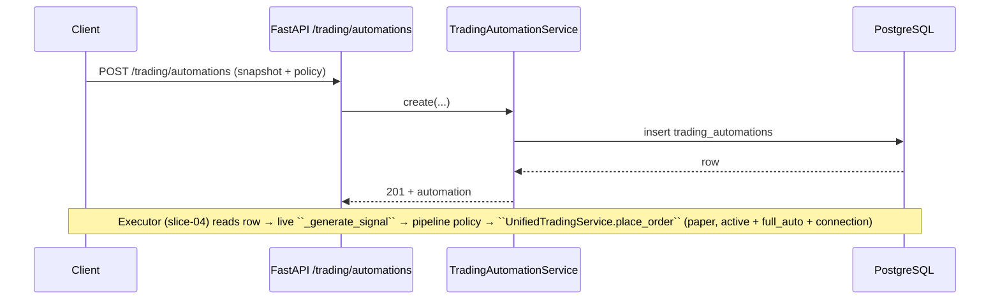

# Trading domain boundaries (living doc)

**Purpose:** Keep a single, evolving map of how trading code is split so refactors stay intentional. Update this file when you touch strategy, execution, or data layers.

## Layers (short)

| Layer              | Owns                                                                  | Must not own                                            |
| ------------------ | --------------------------------------------------------------------- | ------------------------------------------------------- |
| Strategy / signals | What to trade, parameters, risk intent                                | Exchange credentials, raw CCXT calls                    |
| Execution          | Modes (demo/paper/live), idempotency on submit, fill policy, adapters | Long-lived storage of full market history               |
| Data               | Orders, trades, portfolios, append-only events, queries               | Discretionary “fix-up” of executed trades without audit |

## Where to look

- **ADR 001** — `docs/04-structural/adr/001-trading-domain-boundaries.md` — rationale for the split.
- **ADR 002** — `docs/04-structural/adr/002-demo-event-log-and-clock.md` — demo idempotency, append-only demo + paper events, clock SoT.
- **ADR 017** — `docs/08-adr/ADR-017-challenges-trading-arena-hub.md` — Challenges Hub / Trading Arena (paper-first); references `trading_automations`; **no** second execution engine.

## Performance & Review (read-only)

UTC-bucketed daily aggregates (`GET /api/v1/trading/performance/daily`) and per-day trade lists (`GET /api/v1/trading/trades` with `trade_date`) are **read models** over existing demo/paper/live activity. The response `summary.risk` adds **path metrics** (cumulative end, max drawdown, optional % and cumulative÷max DD) on a zero-filled UTC calendar series within the requested window—derived from the same daily rows, not a separate execution path. They must not add a parallel order executor, discretionary trade “fix-ups,” or a journal import pipeline. Any public ranking or follow belongs under **ADR-017**, not under this hub.

### Trade-page Estadísticas read model (Slices 1 + B/C/D/E)

The Estadísticas tab is fed by **two sibling read-model endpoints** (split by **shape**, not by feature) over a UTC inclusive window capped by `TRADING_PERFORMANCE_MAX_RANGE_DAYS`:

1. `GET /api/v1/trading/performance/summary?mode=&exchange_connection_id=&start_date=&end_date=` — **window-scalar KPIs**, served by `TradingSessionStatsService`. Three sibling sections share the same window, each carrying its own `coverage_basis` tag:
   - `closed_trade_performance` — `compute_closed_trade_kpis` (mode-agnostic, generalized in Slice B from `compute_demo_closed_trade_kpis`).
   - `execution_friction` — `compute_execution_friction` (limit fill rate, signed slippage in bps avg + median, market order count). `market_slippage_avg_bps` uses `MarketOrderFill` rows built from trades with persisted `reference_price_usd` / `reference_price_at` (internal quote/base snapshot at the persist contract — demo: request reference on market fill; paper: pipeline reference on placement, copied to `paper_trades` on fill). Excludes fills without reference from the average.
   - `risk_behavior` — `compute_max_loss_streak`, `compute_max_open_notional_usd` (peak running open notional reconstructed from append-only ledger via `LedgerEvent` chronology), `compute_avg_position_duration_seconds` (per-symbol position-cycle average).
2. `GET /api/v1/trading/performance/equity-series?mode=&exchange_connection_id=&start_date=&end_date=&symbol=` — **UTC daily zero-filled cumulative realized P&L time series**, served by `TradingEquitySeriesService`. Sibling of `/summary`, deliberately separate so its different shape and cache rhythm don't pollute the scalar payload.

The **`/daily` ↔ `/summary` ↔ `/equity-series` triplet** is the canonical example of "split by shape, not feature": `/daily` is bucketed PnL + path risk for the calendar widget; `/summary` is scalar KPIs for tile grids; `/equity-series` is a single-line cumulative curve. All three share the same window validator and chronological-load primitives.

**FE chart stroke SoT:** the Estadísticas equity curve uses `SingleEquityCurve` with `getThemeColors().equityCurveLine` (HSL from `PLOTLY_EQUITY_CURVE_LINE_*`, documented alongside `globals.css` `--chart-equity-line`) so light/dark matches the design system instead of a hardcoded hex in the molecule.

**Mode-agnostic primitives (no per-mode branching in math):**

- `compute_avg_cost_realized_pnl_by_id` — per-symbol weighted-average cost realized P&L using `_LedgerAccumulator`. Same primitive backs demo (chronological `demo_trades` + fill-annotation fallback for legacy rows) and paper (chronological `paper_trades`).
- `trading_chronological_loaders` (extracted by **rule of three**, Slice E) — `load_demo_chron_with_annotations`, `load_paper_chron_with_realized_map`, `slice_trades_by_created_at_window`, and realized-PnL resolvers reused by `TradingSessionStatsService` and `TradingEquitySeriesService`.

**Coverage matrix (after Slices B/C/D/E):**

| Mode  | closed_trade_performance | execution_friction | risk_behavior | equity-series |
| ----- | ------------------------ | ------------------ | ------------- | ------------- |
| demo  | available                | available          | available     | available     |
| paper | available                | available          | available     | available     |
| live  | available                | available          | available     | available     |

**Ledger partition (paper vs live):** both modes read the same `paper_trades` / `paper_orders` tables; `GET` query params `mode=paper` vs `mode=live` select rows via `paper_orders.ccxt_use_mainnet` (`false` = sandbox path, `true` = mainnet). Demo uses `demo_*` tables only.

**Honest nullability contract:** every ratio metric (`profit_factor`, `win_rate`, `avg_win_usd`, `avg_loss_usd`, `fees_pct_of_volume`, `limit_fill_rate`, `limit_slippage_avg_bps`, `limit_slippage_median_bps`, `market_slippage_avg_bps`, `max_loss_streak`, `max_open_notional_usd`, `avg_position_duration_seconds`) is `null` when its denominator/inventory is undefined; the FE renders these as `—`. The read model never lies with a `0.00`.

**Still out of scope (separate slices):** per-symbol filter on `/summary`, max-exposure time series, and venue-`info`-only slippage baselines (internal reference on fill rows is SoT — see execution_friction module). None of these add a second execution engine.

## Demo hot path (current)

- `POST /api/v1/trading/orders` with `mode=demo` and optional `Idempotency-Key`.
- `DemoTradingService.place_market_order` — portfolio mutation, `demo_trading_events` append on new success, idempotency row when key present.

## Paper hot path (current)

- `POST /api/v1/trading/orders` with `mode=paper`, an exchange connection, and optional `Idempotency-Key` (replay: same stored order + CCXT payload snapshot, no second submit).

### Paper aggregate position lifecycle (foundation for compound / portfolio)

**Trace (authoritative paths):**

1. **Entry fill** — `PaperPositionService.update_position_after_fill` updates `paper_positions` (increments `fill_count`, avg entry, `total_size`) after a fill is applied to the linked `PaperOrder` / `paper_position_id`.
2. **Bracket / TP-SL close** — Native venue brackets carry the trigger (Phase 6.4 native preset SL/TP for Bitget swap + Binance USDT-M swap, `exchange_spot_plan` plan orders for Bitget spot). The legacy PulsAI-managed Celery sweep (`paper_bracket_celery` + `paper_managed_bracket_sweep`) was deleted in Phase 6.4-finalize. Position closure on venue-triggered exit is reconciled through the standard order-reconciliation poll (`PositionReconciliationService`) which calls `PaperTradingRepository.close_paper_position` when the venue reports the close, setting `is_open=false` and zeroing size fields on the row (optimistic lock on `version`).
3. **Portfolio read** — `GET /trading/portfolio` (`UnifiedTradingService.get_portfolio` → `PaperTradingService.open_positions_for_portfolio_snapshot`) calls `list_open_positions(user_id, connection_id)` which **filters `is_open = true`**. Therefore, after a successful close, **no stale open row** appears when the exchange is flat.
4. **Compound sibling LIMIT cancel on exit** — `CompoundSiblingOrderCleanupService` cancels resting compound **LIMIT** `paper_orders` (same `paper_position_id`, statuses in `PAPER_ORDER_STATUSES_OPEN_FOR_VENUE_CANCEL`) on the venue before the DB close persists. **Venue-flat path:** `PositionReconciliationService._reconcile_under_lock` invokes cleanup when `outcome == closed`, then `close_paper_position`. Persistence uses shared `persist_order_terminal_state_after_venue_cancel`; one append-only `PAPER_EVENT_COMPOUND_SIBLINGS_CANCELLED` per batch (`payload.reason` ∈ `COMPOUND_SIBLING_CLEANUP_REASON_*`). The legacy bracket-sweep wiring (`cancel_compound_limit_legs_before_paper_bracket_close` invoked by `paper_managed_bracket_sweep`) was deleted in Phase 6.4-finalize.

**Acceptance:** closed positions must not appear in `open_positions`; tests cover `open_positions_for_portfolio_snapshot` when `list_open_positions` returns no rows.

### Trading automation (manual vs auto — Slice 1+)

**Bounded context:** `trading_automations` table holds the **strategy snapshot JSON** + **execution policy** (`execution_leg_mode`, etc.). Execution still routes through **one** `UnifiedTradingService.place_order` path in later slices; the automation row is policy SoT, not a second order engine. **PATCH invariant:** `strategy_snapshot` may change only while `status=draft` (`TradingAutomationService.update` uses the row’s pre-update draft flag so activate + snapshot can ship in one request).

### Idempotency key scope (demo + paper)

Keys are **per authenticated user** (`user_id` + `Idempotency-Key`), not globally unique. Two different users may send the same header value without sharing deduplication. Cross-exchange or broker-global idempotency, if ever required, would need a separate contract (namespaced keys, exchange-scoped storage, or both)—do not assume the HTTP header alone is unique across users or venues.

- `PaperOrderPersistenceHelper.persist_after_execution` — after `PaperTrade` insert on fill, append `paper_trading_events` (`trade_executed`).
- `paper_fill_resolve` task — after async fill + `add_trade`, same append (payload `source=paper_fill_resolve`).

## USDS-M / swap close semantics (venue matrix)

Manual **swap** exits (e.g. Órdenes **Cerrar** on a filled long) must not flip net exposure into an unintended **short** on one-way books. **Slice 1** threads `reduce_only` on `POST /trading/orders` into CCXT `params["reduceOnly"]=true` for **one-way** Binance USDS-M accounts (see [Binance New Order — `reduceOnly`](https://developers.binance.com/docs/derivatives/usds-margined-futures/trade/rest-api/New-Order)). **Hedge mode** forbids sending `reduceOnly` on that endpoint; closes use **`positionSide`** + opposite **side** (implemented in futures adapters when `futures_position_mode=hedge`). **Bitget** may not expose `fetchPositionMode` in CCXT; UI/API surface `futures_position_mode: unknown` until a readonly Bitget path exists.

`GET /trading/portfolio` (paper/live) includes **`futures_position_mode`**: `one_way` \| `hedge` \| `unknown` (venue-sourced, read-only in UI — never a client toggle).

## Changelog

- 2026-05-09: Trade-page Estadísticas read model — Slices B/C/D/E: paper P&L parity via mode-agnostic `compute_avg_cost_realized_pnl_by_id`; `/summary` extended with `execution_friction` + `risk_behavior` sibling sections (per-section `coverage_basis`); new `GET /api/v1/trading/performance/equity-series` for UTC daily cumulative time series; chronological loaders extracted to `trading_chronological_loaders`. Live mode still `demo_only`. Follow-up same day: `reference_price_usd` / `reference_price_at` on `demo_trades` + `paper_trades` (and `placement_reference_*` on `paper_orders` for async fills) powers `market_slippage_avg_bps` via internal reference only (not venue `info` as SoT).
- 2026-05-09: Trade-page Estadísticas read model (Slice 1) — `GET /api/v1/trading/performance/summary` (demo only, `coverage_basis` flag, honest-null ratios).
- 2026-05-20: Phase 6.4-finalize — PulsAI-managed bracket sweep deleted (`paper_bracket_celery`, `paper_managed_bracket_sweep`, `paper_exit_strategy_policy`, `SLTP_STRATEGY_PULSAI_MANAGED`). Native venue brackets + `exchange_spot_plan` plan orders are the only paths; position exit reconciliation rides the order-reconciliation poll.
- 2026-04-25: Bracket sweep (`check_paper_brackets` → `paper_managed_bracket_sweep.check_paper_brackets_sweep`) runs `cancel_compound_limit_legs_before_paper_bracket_close` before market close `create_order` when a `paper_position_id` is present. _(Superseded 2026-05-20.)_
- 2026-04-23: Paper lifecycle §4 — compound sibling LIMIT cancel on exit (`CompoundSiblingOrderCleanupService`, `PAPER_EVENT_COMPOUND_SIBLINGS_CANCELLED`).
- 2026-04-23: Documented swap close `reduce_only` / hedge `positionSide` matrix + portfolio `futures_position_mode` field.
- 2026-04-14: Documented draft-only `strategy_snapshot` PATCH invariant (`TradingAutomationService.update`).
- 2026-04-17: Cross-link ADR-017 (Challenges Hub / Arena) in “Where to look”.
- 2026-04-14: Paper position lifecycle trace + portfolio `is_open` contract; trading automation bounded context (slice-01 skeleton).
- 2026-04-14: Initial boundaries + ADR 001/002; demo idempotency + `trade_executed` events.
- 2026-04-14: Paper `paper_trading_events` + `PAPER_EVENT_TRADE_EXECUTED` (ADR 002 amended).
- 2026-04-14: Paper `paper_trading_idempotency` + replay response + audit skip on replay.
- 2026-04-14: Documented per-user idempotency scope (not global across users or venues).
